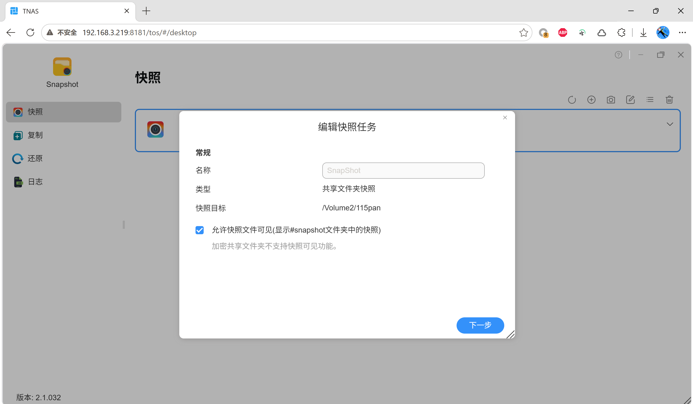
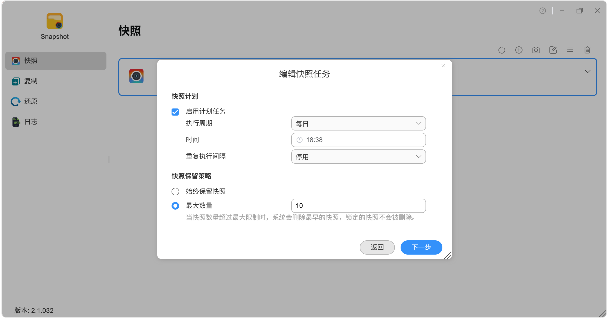
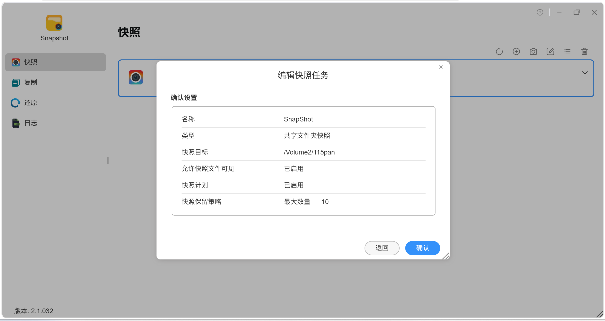
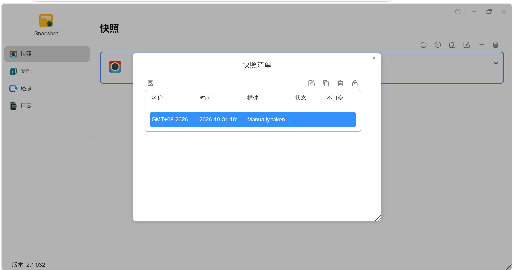
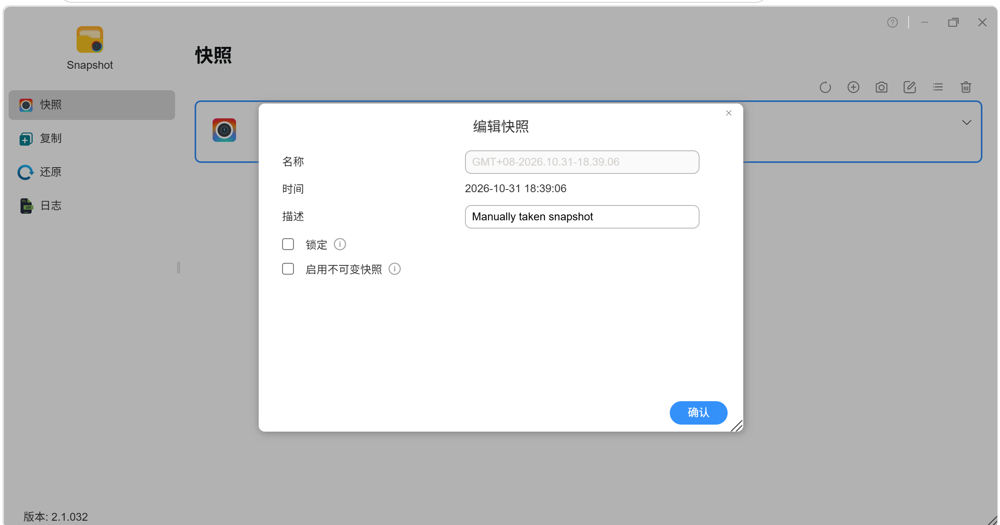
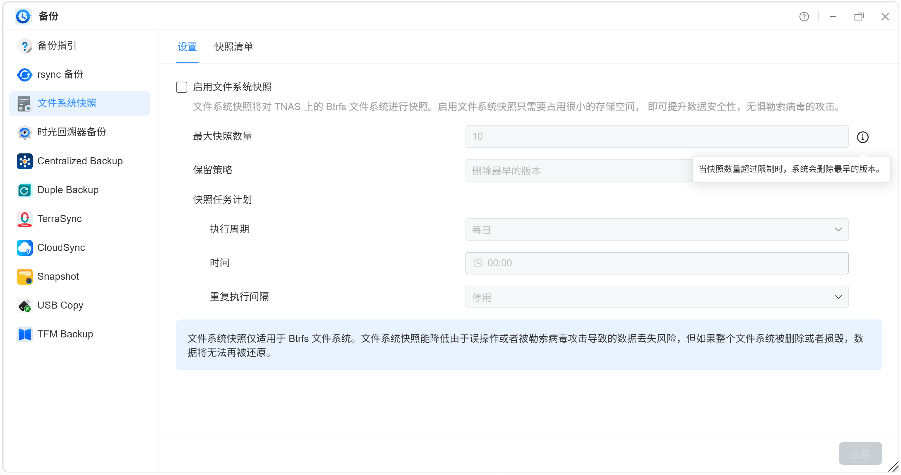
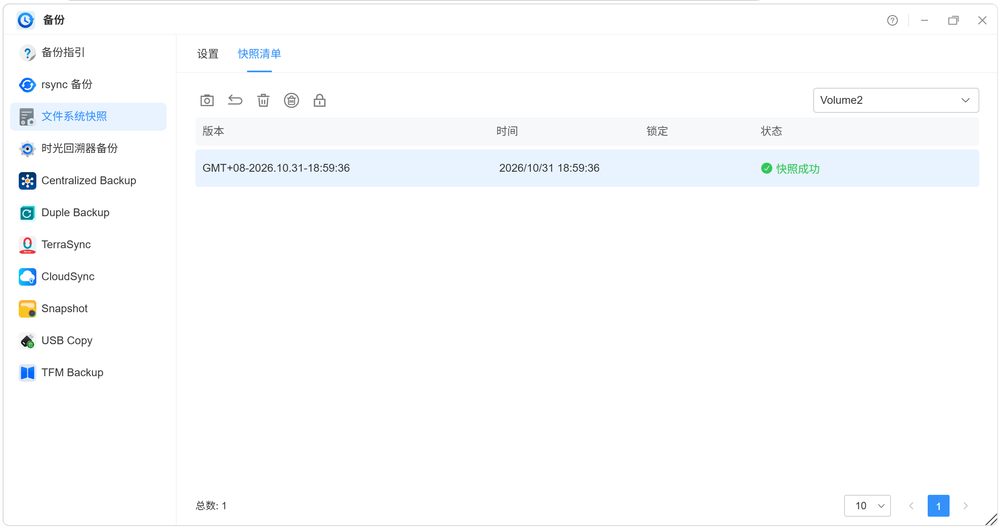

# 铁威马 TOS 7.0.1341 不可变快照实测记录

> 本页面内容由 AI 汇总生成，仅供参考。
> 如内容涉及侵权，请联系邮箱 **lin_yb@88.com**，核实后删除。

## 背景速记（问题 → 结论）

群晖勒索事件后想了解「不可变快照」，实测铁威马（TOS 7.0.1341 + 快照 2.1.032，型号 F4-225）的不可变快照支持情况：

- **问题**：快照任务（计划）、文件系统快照设置里都没有「不可变」选项，不可变快照只能手动启用。
- **结论**：不可变是**快照级**能力，且默认不开启——拍完快照后需在快照清单里选中 → 编辑 → 勾选「启用不可变快照」。
- **定位**：铁威马把「防篡改」主战场放在 HyperLock-WORM（文件级 WORM，最长 70 年保护期），快照层不可变是补充功能。防勒索场景下「手动 + 保护窗口期 + 依赖人工纪律」是真实短板；日常误删恢复场景基本够用。

一句话总结：**能力有、自动化没有**——功能存在且可用，但把启用责任完全推给管理员。

## 文档

| 文档 | 说明 |
|---|---|
| [docs/terramaster-tos-immutable-snapshot.md](docs/terramaster-tos-immutable-snapshot.md) | 逐张截图确认结果 + AI 客观评论（事实 / 设计合理性 / 使用代价 / 体系定位） |

## 截图附件（界面逐项确认）

| 截图 | 界面 | 是否有「不可变」选项 |
|---|---|---|
|  | 编辑快照任务・常规 | ❌ 无 |
|  | 编辑快照任务・确认设置 | ❌ 无 |
|  | 编辑快照任务・计划 | ❌ 无（仅说明「锁定的快照不会被删除」） |
|  | 快照清单 | ⚠️ 列表里才有不可变状态列 |
|  | 编辑快照（勾选「启用不可变快照」） | ✅ 这里才有 |
|  | 备份・文件系统快照设置 | ❌ 无 |
|  | 备份・文件系统快照列表 | ❌ 无（只有锁定防止误删） |

## 适用机型 / 注意事项

- 实测型号：铁威马 F4-225；系统 TOS 7.0.1341；快照套件 2.1.032。其他型号 / 系统版本可能有差异，以实际界面为准。
- 保留策略只保护「已锁定」的快照；从快照生成到手动锁定之间存在保护窗口期。
- 官方明确提示：如果整个文件系统被删除或损毁，快照数据将无法还原——快照不是「终极防线」。
- 需要文件级 WORM 防护时，铁威马体系内对应的是 HyperLock-WORM，而非快照。

## 使用步骤

1. 打开本文档，按截图核对你的铁威马界面选项。
2. 如需对某条快照启用不可变：快照清单 → 选中快照 → 编辑 → 勾选「启用不可变快照」。
3. 日常防勒索建议：配合 HyperLock-WORM 使用，并定期检查快照锁定状态。

## 免责声明

- 本仓库内容基于作者个人实测整理，仅供技术参考，不构成任何保证。
- 截图界面可能随系统 / 套件版本更新而变化。
- 如内容涉及侵权，请联系邮箱 **lin_yb@88.com**，核实后删除。
