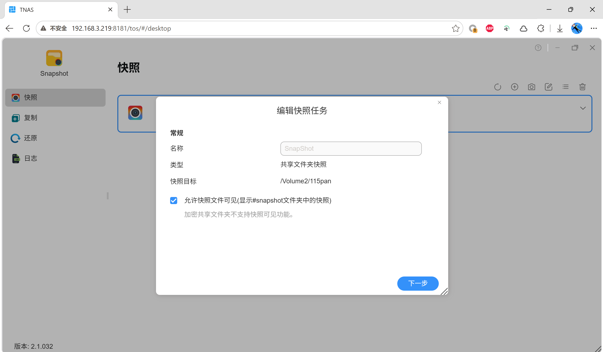
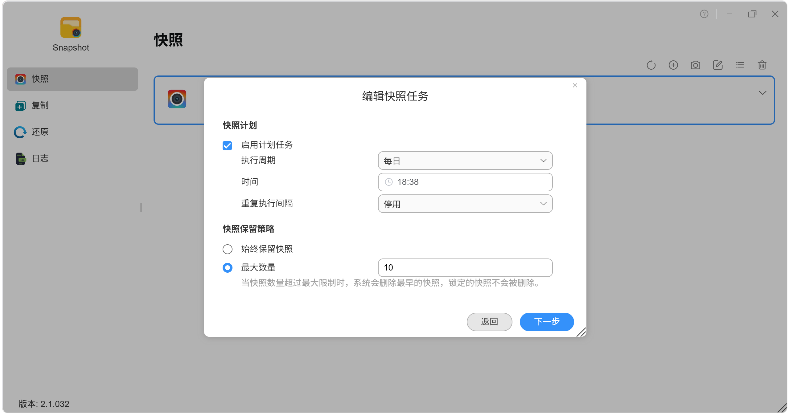
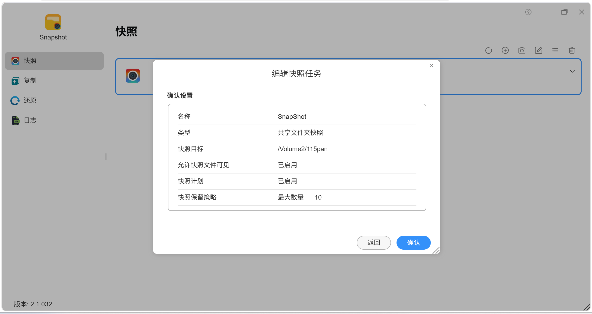
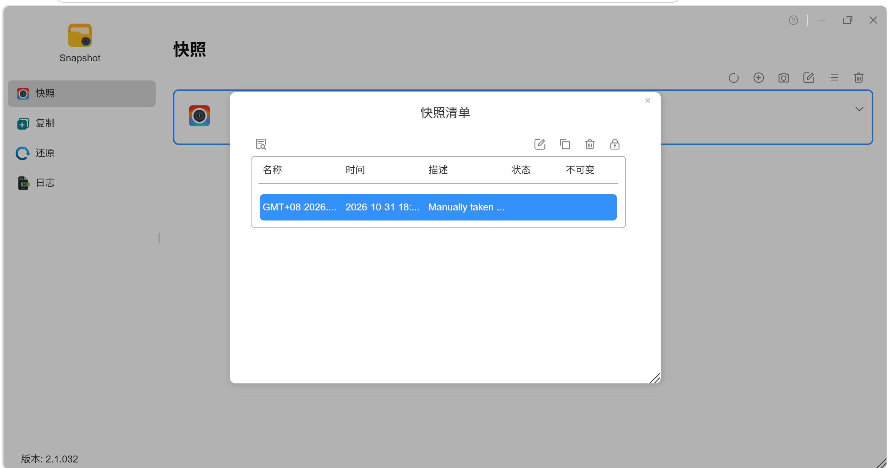
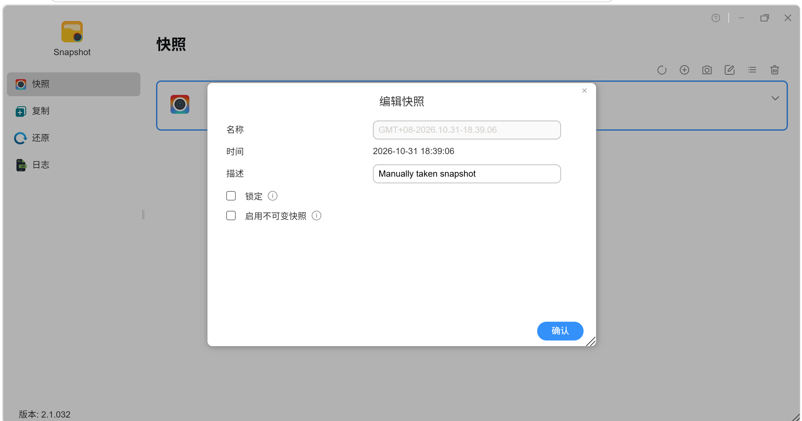
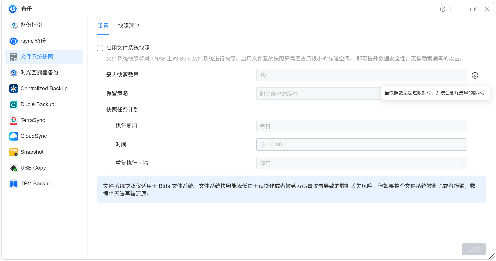
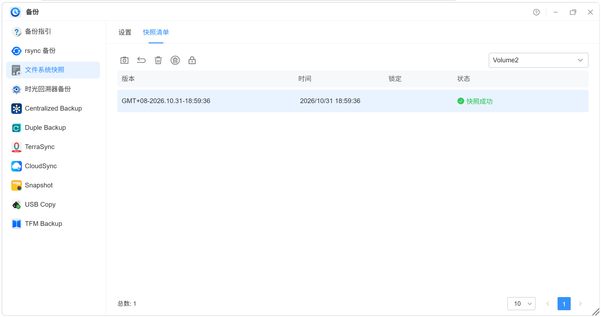

# 铁威马TOS7.0.1341没有不可变快照的坑

最近群晖勒索时间，看到一个技术，不可变快照，检查了下铁威马的不可变快照情况

铁威马的不可变快照在任务里面设置没有，只能拍完后，选中快照，将快照设置为不可变

快照版本2.1.032

系统版本7.0.1341

型号铁威马F4-225

## 逐张截图确认结果

|                                               |                                                                 |                                          |
|-----------------------------------------------|-----------------------------------------------------------------|------------------------------------------|
| 截图                                          | 界面                                                            | 有没有 "不可变" 选项                     |
|  | 编辑快照任务・常规（名称 / 类型 / 快照目标 / 允许快照文件可见） | ❌ 无                                    |
|  | 编辑快照任务・确认设置（快照计划 / 保留策略 = 最大数量 10）     | ❌ 无                                    |
|  | 编辑快照任务・计划（每日 18:38 / 最大数量 10）                  | ❌ 无（只有说明 "锁定的快照不会被删除"） |
|  | 快照清单（有 "不可变" 列 + 锁定操作图标）                       | ⚠️ 列表里才有不可变状态列                |
|  | **编辑快照**（勾选 "启用不可变快照"）                           | ✅ 这里才有                              |
|  | 备份・文件系统快照设置（启用 / 最大数量 / 保留策略 / 计划）     | ❌ 无                                    |
|  | 备份・文件系统快照列表没有不可变快照功能，只有锁定防止误删      | ❌ 无                                    |

以下是AI总结

# 铁威马 "快照不可变只能手动启用" 的客观评论

## 一、事实层面（现状）

- TOS 7.0.1341 + 快照 2.1.032：快照任务（计划）、文件系统快照设置里**都没有**"不可变" 选项

- 唯一入口是拍完快照后，在快照清单里选中 → 编辑 → 勾选 "启用不可变快照"

- 保留策略只保护 "已锁定" 的快照（界面明确写着 "锁定的快照不会被删除"）

- 结论：**不可变是 "快照级" 的，且默认不开启**—— 系统把 "是否锁定" 这个决定完全交给管理员事后处理

## 二、从设计角度：它有什么合理性

1.  **不可变是 "重" 操作**：锁定意味着占用不可回收、删除前需解锁，默认开启会让普通快照也变成 "死空间"，保留策略形同虚设。让管理员手动挑 "值得锁的"，是给了选择权

2.  **符合产品分层的逻辑**：铁威马把 "防篡改" 的主战场放在 HyperLock-WORM 文件系统（文件级 WORM，可设最长 70 年保护期），快照层的不可变更像是 "补充功能" 而非 "主防线"—— 所以它没有花精力去做任务级自动化

3.  **手动启用也有好处**：可精确控制哪些快照进保护期，避免 "所有计划快照全部锁定、想删删不掉" 的管理困境

## 三、从使用角度：客观代价

1.  **存在保护窗口期**：从快照生成到手动勾选锁定之间，快照是 "裸" 的，可被保留策略或任何有权限者删除

2.  **依赖人工纪律**：忘了锁定 = 没有保护。对防勒索场景，"靠记得" 本身就是风险点

3.  **操作成本高**：如果每天计划拍多组快照，每拍完一组要手动去清单里编辑锁定，长期看是持续的手工负担

4.  **"锁定的快照不会被删除" 是它的承诺，但没有说明锁定后能否快速解除**—— 批量管理锁定 / 解锁的体验有待观察

## 四、体系内的补充（铁威马自己的说法）

- 官方对文件系统快照的定位描述是 "降低误操作或被勒索病毒攻击导致的数据丢失风险"，但**同时明确提示 "如果整个文件系统被删除或损毁，数据将无法还原"**

- 即：铁威马官方对快照层的定位本身就不是 "终极防线"，它承认快照救不了 "卷没了" 的场景

- 要真正的不可变防护，铁威马体系内对应的是 HyperLock-WORM（文件级），而非快照

## 客观判断

- **它不是 "错误"，更像 "取舍"**：铁威马把不可变的深度做在了文件级 WORM 上，快照级不可变停留在 "手动、补充" 的形态

- **但对防勒索这个具体目标，这个取舍是有代价的**：手动 + 窗口期 + 靠纪律，恰好削弱了快照在勒索场景下的 "无需人为干预即可兜底" 的价值

- **是否构成 "坑"，取决于用途**：如果你把它当 "日常误删恢复工具"，够用；如果你把它当 "勒索对抗防线"，它的快照层确实不够自动化 —— 这是它自身的定位问题，不是功能 bug

一句话总结：**铁威马快照不可变的现状是 "能力有、自动化没有"—— 功能存在且可用，但把启用责任完全推给管理员，这在防勒索场景下是真实的短板，在一般误删恢复场景下则基本够用。**
